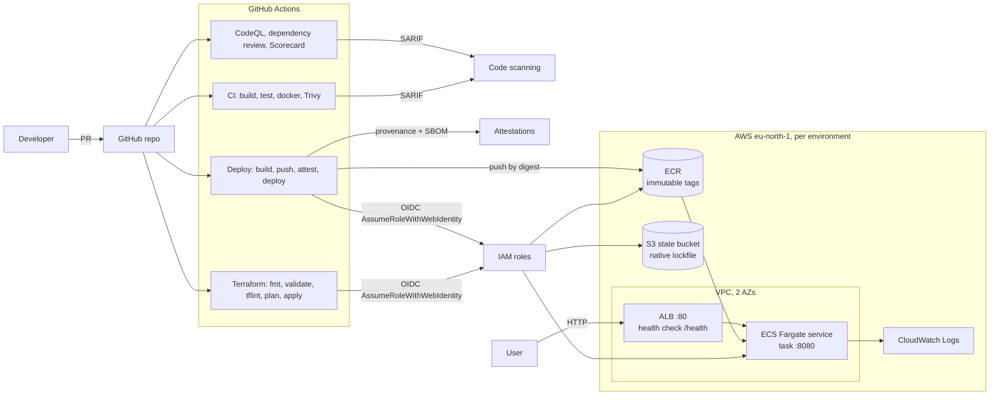
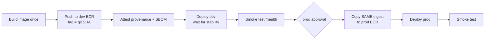

# cicd-playground

[](https://github.com/ThomasSiigNoergaard/cicd-playground/actions/workflows/ci.yml)
[](https://github.com/ThomasSiigNoergaard/cicd-playground/actions/workflows/codeql.yml)
[](https://github.com/ThomasSiigNoergaard/cicd-playground/actions/workflows/terraform.yml)
[](https://github.com/ThomasSiigNoergaard/cicd-playground/actions/workflows/deploy.yml)
[](https://scorecard.dev/viewer/?uri=github.com/ThomasSiigNoergaard/cicd-playground)
[](LICENSE)

A hands-on lab for modern CI/CD on GitHub. A small .NET 9 minimal API is built,
tested, scanned, signed (attested) and deployed to AWS ECS Fargate with
Terraform, using GitHub OIDC instead of AWS keys, GitHub Advanced Security for
supply chain security, and Copilot for AI-assisted development.

Everything is commented where it teaches something. Start with the
[guided walkthrough](#guided-walkthrough) and dip into [docs/](docs/) for depth.

## What is in here

| Area | What you get | Deep dive |
| --- | --- | --- |
| App | .NET 9 minimal API, structured JSON logs, built-in OpenAPI, health checks, xUnit + WebApplicationFactory tests with coverlet coverage | - |
| Container | Multi-stage build, digest-pinned `aspnet:9.0-noble-chiseled` runtime, non-root, port 8080 | [docs/supply-chain.md](docs/supply-chain.md) |
| CI | Reusable .NET workflow, test report + coverage in the job summary, buildx with GHA cache, Trivy image scan to code scanning, single `CI - Required Checks` aggregator, merge queue ready | [docs/releases.md](docs/releases.md) |
| Releases | Conventional PR titles (linted) drive SemVer tags and GitHub releases via a reusable workflow | [docs/releases.md](docs/releases.md) |
| Security | CodeQL (C# + Actions), zizmor workflow audit, dependency review, Dependabot with cooldown, Trivy IaC scan, OpenSSF Scorecard, build provenance + SBOM attestations | [docs/supply-chain.md](docs/supply-chain.md) |
| AWS auth | GitHub OIDC with per-environment IAM roles, no long-lived keys | [docs/oidc.md](docs/oidc.md) |
| Infra | Terraform bootstrap (S3 state with native locking, OIDC, roles), shared `app` module, `dev` and `prod` roots | [docs/terraform.md](docs/terraform.md) |
| Delivery | Build once, deploy dev, smoke test, approve, promote the same digest to prod | - |
| AI tooling | Copilot instructions, path-scoped instructions, coding agent setup steps, code review, Autofix | [docs/ai-tooling.md](docs/ai-tooling.md) |
| Agentic workflows | gh-aw Markdown workflows: issue triage, CI doctor, weekly status (read-only agent, writes via safe-outputs) | [docs/agentic-workflows.md](docs/agentic-workflows.md) |

## Architecture



Delivery flow on every merge to `main`:



## Repository layout

```text
src/CicdPlayground.Api/         .NET 9 minimal API
tests/CicdPlayground.Api.Tests/ xUnit integration tests (WebApplicationFactory)
Dockerfile, .dockerignore       Multi-stage, chiseled, non-root image
terraform/bootstrap/            Run once locally: state bucket, OIDC provider, IAM roles
terraform/modules/app/          VPC, ALB, ECS, ECR, logs, IAM, security groups
terraform/environments/dev|prod Thin root modules that call modules/app
.github/workflows/              ci, _dotnet (reusable), codeql, dependency-review, scorecard, zizmor,
                                terraform, _terraform-apply (reusable), deploy, release, _release (reusable),
                                pr-title, copilot-setup-steps, and gh-aw agentic workflows (*.md + *.lock.yml)
.github/aw/                     gh-aw action pin lock (generated)
.github/actions/                Composite actions: ecs-deploy, terraform-outputs
.github/instructions/           Path-scoped Copilot instructions
scripts/                        terraform-check.sh / .ps1 (fmt, validate, tflint for every stack)
docs/                           Deep dives
```

### API endpoints

| Method | Path | Purpose |
| --- | --- | --- |
| GET | `/` | Service name, version (`APP_VERSION`) and commit (`GIT_COMMIT_SHA`) |
| GET | `/health` | ASP.NET Core health checks (used by the ALB and ECS) |
| GET | `/weatherforecast` | Demo endpoint |
| GET | `/openapi/v1.json` | OpenAPI document |

### Why separate `dev` and `prod` root folders instead of one root with tfvars?

Each environment is a tiny root module (`terraform/environments/<env>`) that
calls the shared `modules/app`. Compared with a single root plus
`dev.tfvars`/`prod.tfvars` or workspaces:

- **Blast radius and clarity:** every environment has its own state key,
  backend config and lock file, and you can see exactly which inputs prod uses
  by opening one folder. There is no "which tfvars did I pass?" mistake.
- **Safe divergence:** prod can enable things dev does not (longer log
  retention, Container Insights) without conditionals sprinkled in one root.
- **Clean CI mapping:** each folder maps 1:1 to a GitHub environment and an
  IAM role, which makes the OIDC trust story easy to reason about.

The cost is a little duplication in the thin roots, which is deliberate and
small. All real logic lives in the module. More in [docs/terraform.md](docs/terraform.md).

### Cost-conscious networking default

By default the Fargate tasks run in **public subnets with a public IP** and no
NAT gateway. They are still only reachable from the ALB security group. This
saves roughly 35+ USD per month per environment. Set `use_private_subnets = true`
in an environment to move tasks to private subnets behind a single NAT gateway
(the production-grade layout). See the comments in
`terraform/modules/app/variables.tf`.

## Guided walkthrough

Prerequisites: .NET 9 SDK, Docker, Terraform >= 1.10 (CI uses 1.13.4), the
GitHub CLI (`gh auth login`), and the AWS CLI with admin credentials for one
AWS account (only needed for step 4).

### 1. Run it locally

```bash
dotnet restore
dotnet build
dotnet test --collect:"XPlat Code Coverage"
dotnet run --project src/CicdPlayground.Api
# in another terminal
curl http://localhost:8080/
curl http://localhost:8080/health
curl http://localhost:8080/openapi/v1.json
```

With Docker:

```bash
docker build -t cicd-playground:local \
  --build-arg APP_VERSION=local --build-arg GIT_COMMIT_SHA=$(git rev-parse HEAD) .
docker run --rm -p 8080:8080 cicd-playground:local
docker ps   # STATUS shows (healthy) after the HEALTHCHECK passes
```

Run the Terraform static checks for every stack (no AWS needed):

```bash
./scripts/terraform-check.sh       # or: pwsh ./scripts/terraform-check.ps1
```

### 2. Enable repository security settings

In **Settings -> Advanced Security** (free for public repos), enable:

- Dependency graph, **Dependabot alerts** and **Dependabot security updates**
- **Secret scanning** and **Push protection** (and Copilot secret scanning /
  generic secret detection, see [docs/ai-tooling.md](docs/ai-tooling.md))
- **Private vulnerability reporting** (used by [SECURITY.md](SECURITY.md))
- **Code scanning**: this repo uses the *advanced* CodeQL setup
  (`.github/workflows/codeql.yml`), so leave default setup **off** to avoid a
  conflict. Trivy and Scorecard upload SARIF to the same code scanning page.
- **Copilot Autofix** for code scanning alerts

Most of these can also be set from the CLI:

```bash
gh api -X PATCH repos/ThomasSiigNoergaard/cicd-playground \
  -f 'security_and_analysis[secret_scanning][status]=enabled' \
  -f 'security_and_analysis[secret_scanning_push_protection][status]=enabled'
gh api -X PUT repos/ThomasSiigNoergaard/cicd-playground/vulnerability-alerts
gh api -X PUT repos/ThomasSiigNoergaard/cicd-playground/automated-security-fixes
gh api -X PUT repos/ThomasSiigNoergaard/cicd-playground/private-vulnerability-reporting
```

Protect `main` with a ruleset and switch to squash merges. Because PR titles
become the squash commit and drive releases, and because CI ends in a single
aggregator job, only two status checks need requiring: `CI - Required Checks`
and `Conventional PR title`. The full `gh api` commands (repo merge settings
and the ruleset JSON) are in [docs/releases.md](docs/releases.md). The check
names appear in the ruleset picker after the first PR run.

### 3. Create the `dev` and `prod` GitHub environments

`prod` gets a required reviewer (you) and may only deploy from `main`.

```bash
REPO=ThomasSiigNoergaard/cicd-playground
MY_ID=$(gh api user --jq .id)

gh api -X PUT repos/$REPO/environments/dev

gh api -X PUT repos/$REPO/environments/prod --input - <<EOF
{
  "reviewers": [{ "type": "User", "id": $MY_ID }],
  "prevent_self_review": false,
  "deployment_branch_policy": { "protected_branches": false, "custom_branch_policies": true }
}
EOF
gh api -X POST repos/$REPO/environments/prod/deployment-branch-policies \
  -f name=main -f type=branch
```

`prevent_self_review` is `false` because you are the only reviewer in a
personal lab. In a team you would set it to `true`.

### 4. Bootstrap AWS (once, locally, with admin credentials)

This creates the S3 state bucket (versioned, encrypted, TLS only, native
`use_lockfile` locking), the GitHub OIDC provider and the IAM roles. It is the
only time admin credentials are used; from then on GitHub uses OIDC.

```bash
aws sts get-caller-identity          # confirm the right account
cd terraform/bootstrap
terraform init
terraform plan -out tfplan
terraform apply tfplan
terraform output
```

If the account already has an OIDC provider for
`token.actions.githubusercontent.com`, add `-var create_oidc_provider=false` to
plan. The bootstrap state stays local (`terraform.tfstate` in this folder, git
ignored). Keep it safe, you need it for teardown. Why and how in
[docs/oidc.md](docs/oidc.md) and [docs/terraform.md](docs/terraform.md).

### 5. Set the GitHub variables from the bootstrap outputs

These are **variables**, not secrets: role ARNs and bucket names are not
sensitive, and OIDC means there is no secret to store. Bootstrap prints the
exact commands:

```bash
terraform output -raw gh_variable_commands
```

They look like this (values from your account):

```bash
gh variable set AWS_REGION        --repo ThomasSiigNoergaard/cicd-playground --body 'eu-north-1'
gh variable set TF_STATE_BUCKET   --repo ThomasSiigNoergaard/cicd-playground --body 'cicd-playground-tfstate-<account>-eu-north-1'
gh variable set AWS_PLAN_ROLE_ARN --repo ThomasSiigNoergaard/cicd-playground --body 'arn:aws:iam::<account>:role/cicd-playground-github-plan'
gh variable set AWS_DEPLOY_ROLE_ARN --repo ThomasSiigNoergaard/cicd-playground --env dev  --body 'arn:aws:iam::<account>:role/cicd-playground-github-deploy-dev'
gh variable set AWS_DEPLOY_ROLE_ARN --repo ThomasSiigNoergaard/cicd-playground --env prod --body 'arn:aws:iam::<account>:role/cicd-playground-github-deploy-prod'
```

Check with `gh variable list` and `gh variable list --env prod`. Until these
are set, every AWS job skips with a notice in the job summary instead of
failing.

### 6. Open a test PR

Make a small change under `terraform/` (for example a tag value) and in
`src/`, then open a PR. Watch:

- **CI**: test report and coverage in the job summary, Trivy image scan, and
  the `CI - Required Checks` aggregator
- **Terraform**: fmt/validate/tflint, Trivy IaC scan, and a plan for `dev`
  and `prod` posted as PR comments (updated in place on each push)
- **CodeQL**, **Dependency review** (comment on the PR when dependencies change)
- **PR title**: try a title like `Update stuff` and watch it fail, then rename
  it to `feat: add greeting endpoint`
- **zizmor** (when `.github/` changes): workflow security audit, findings in
  **Security -> Code scanning**
- **Copilot code review**, if you enabled it in step 9

### 7. Merge and watch the deployment

On merge to `main`:

1. **Release** tags a new version and creates a GitHub release if the squash
   commit is a `feat:` or `fix:` (see [docs/releases.md](docs/releases.md)).
2. **Terraform** applies `dev`, then waits for your approval on `prod`.
3. **Deploy** builds the image once, pushes it to the dev ECR tagged with the
   git SHA, attests provenance and SBOM, deploys to dev, waits for service
   stability and smoke tests `/health` via the ALB. It then waits for your
   approval on `prod`, copies the **same digest** to the prod ECR and deploys.

Approve under **Actions -> the run -> Review deployments**. The environment URLs
(the ALB) show on the run and under **Deployments** on the repo home page.

> **First merge caveat:** Terraform and Deploy start in parallel. On the very
> first merge the ECR repos and ECS services do not exist yet, so Deploy may
> fail. Once Terraform has applied both environments, rerun it:
> `gh workflow run deploy.yml --ref main`.

```bash
cd terraform/environments/dev
terraform init -backend-config="bucket=<TF_STATE_BUCKET>" -backend-config="region=eu-north-1"
curl "$(terraform output -raw alb_url)/"
```

### 8. Verify the attestations

Each pushed image has a SLSA build provenance attestation and an SPDX SBOM
attestation, stored both in GitHub and next to the image in ECR.

```bash
aws ecr get-login-password --region eu-north-1 \
  | docker login --username AWS --password-stdin <account>.dkr.ecr.eu-north-1.amazonaws.com
IMAGE=<account>.dkr.ecr.eu-north-1.amazonaws.com/cicd-playground-dev@sha256:<digest>

# Provenance: was this exact digest built by this repo's workflow?
gh attestation verify oci://$IMAGE -R ThomasSiigNoergaard/cicd-playground

# SBOM attestation
gh attestation verify oci://$IMAGE -R ThomasSiigNoergaard/cicd-playground \
  --predicate-type https://spdx.dev/Document/v2.3

# Stricter: pin the signer workflow too
gh attestation verify oci://$IMAGE -R ThomasSiigNoergaard/cicd-playground \
  --signer-workflow ThomasSiigNoergaard/cicd-playground/.github/workflows/deploy.yml
```

The digest is in the Deploy run summary. See also **Actions -> Attestations**.
Details in [docs/supply-chain.md](docs/supply-chain.md).

### 9. Try the Copilot features

See [docs/ai-tooling.md](docs/ai-tooling.md) for step by step setup of:

- **Copilot code review** on every PR via a branch ruleset
- **Copilot Autofix** for CodeQL / code scanning alerts
- **Copilot coding agent**: open an issue with the *Feature request* template
  and assign it to Copilot. The agent uses
  `.github/workflows/copilot-setup-steps.yml` and follows
  `.github/copilot-instructions.md` plus `.github/instructions/*.instructions.md`.
- **Copilot secret scanning** (generic secret detection)
- **GitHub Agentic Workflows**: issue triage, CI doctor and a weekly status
  report written in Markdown. They are off until you add a token and flip a
  variable:

  ```bash
  gh secret set COPILOT_GITHUB_TOKEN    # fine-grained PAT with "Copilot Requests"
  gh variable set AGENTIC_WORKFLOWS_ENABLED --body true
  ```

  Then open an issue and watch it get labelled. Details and the security model
  are in [docs/agentic-workflows.md](docs/agentic-workflows.md).

### 10. Teardown and costs

Rough running cost with the defaults (eu-north-1, per environment, 24/7):
ALB about 18-20 USD/month, one 0.25 vCPU / 0.5 GB Fargate task about 9-10
USD/month, plus small amounts for public IPv4 addresses, CloudWatch Logs and
ECR storage. Both environments together are roughly 60 USD/month. A NAT
gateway (`use_private_subnets = true`) adds about 35+ USD/month per
environment. **Destroy when you are done practising.**

```bash
# 1. Environment stacks (prod first, then dev)
for env in prod dev; do
  (cd terraform/environments/$env && \
    terraform init -backend-config="bucket=<TF_STATE_BUCKET>" -backend-config="region=eu-north-1" && \
    terraform destroy)
done

# 2. Bootstrap: the state bucket has prevent_destroy as a safety net.
#    Remove the `prevent_destroy = true` line in terraform/bootstrap (do not commit it),
#    empty the versioned bucket, then destroy.
cd terraform/bootstrap
aws s3api delete-objects --bucket <TF_STATE_BUCKET> --delete "$(aws s3api list-object-versions \
  --bucket <TF_STATE_BUCKET> --output json \
  --query '{Objects: [Versions, DeleteMarkers][][].{Key: Key, VersionId: VersionId}}')"
terraform destroy
```

Then delete the GitHub variables (`gh variable delete ...`) if you want a clean
slate. The ECR repositories are created with `force_delete` (module variable
`ecr_force_delete`, default `true` for this lab), so destroy removes them even
when they still contain images. Full notes in
[docs/terraform.md](docs/terraform.md).

## Conventions

- Every third-party action is pinned to a full commit SHA with a `# vX.Y.Z`
  comment; Dependabot keeps them current.
- Workflows start with `permissions: {}` and grant least privilege per job.
  `zizmor` and `actionlint` audit every workflow change.
- No long-lived cloud credentials anywhere. AWS access is OIDC only.
- Conventional commits and PR titles (`feat:`, `fix:`, `ci:`, `docs:`,
  `chore:`, `build:`). PRs are squash merged, so the PR title decides the
  release: `feat` is minor, `fix` is patch, `!` is major. Dependabot uses
  `build(deps):`, which does not release.

## License

[MIT](LICENSE)
