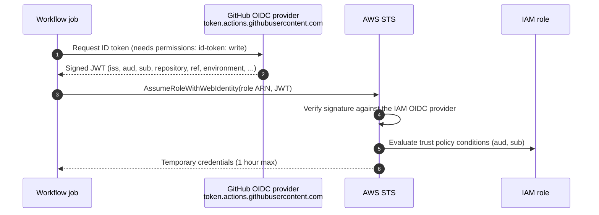

# GitHub Actions to AWS with OIDC (no long-lived keys)

This repo contains **no AWS access keys** - not as secrets, not anywhere. Every workflow that talks to AWS gets short-lived credentials (one hour at most) through OpenID Connect (OIDC).

## How it works



`aws-actions/configure-aws-credentials` carries out steps 1 and 3 for you. The job only needs:

```yaml
permissions:
  id-token: write   # allow the job to request the OIDC JWT
  contents: read
steps:
  - uses: aws-actions/configure-aws-credentials@<sha> # v6.x
    with:
      role-to-assume: ${{ vars.AWS_DEPLOY_ROLE_ARN }}
      aws-region: ${{ vars.AWS_REGION }}
```

## The `sub` claim is the security boundary

GitHub builds the token's `sub` (subject) claim from the context the job runs in:

| Job context | `sub` claim |
|---|---|
| A job with `environment: prod` | `repo:ThomasSiigNoergaard/cicd-playground:environment:prod` |
| A `pull_request` job with no environment | `repo:ThomasSiigNoergaard/cicd-playground:pull_request` |
| A push to main with no environment | `repo:ThomasSiigNoergaard/cicd-playground:ref:refs/heads/main` |

The trust policies in [`terraform/bootstrap/iam.tf`](../terraform/bootstrap/iam.tf) match these values with `StringEquals`, never with a broad `StringLike` such as `repo:*`:

| Role | Accepts `sub` | Used by | Permissions |
|---|---|---|---|
| `cicd-playground-github-plan` | `...:pull_request` | `terraform plan` on PRs | `ReadOnlyAccess`, plus read access to state and writes to the `.tflock` object only |
| `cicd-playground-github-deploy-dev` | `...:environment:dev` | `terraform apply` and app deploy to dev | Scoped write access (see below) |
| `cicd-playground-github-deploy-prod` | `...:environment:prod` | `terraform apply` and app deploy to prod | Scoped write access (see below) |

Each trust policy also pins `aud = sts.amazonaws.com`. Without that check, a token minted for some other audience could be replayed against AWS.

### Why environments make prod safe

Only a job that declares `environment: prod` can obtain a token whose subject ends in `environment:prod`. The `prod` environment in GitHub has two protection rules:

- **Required reviewers.** The job cannot start, and so cannot even request a token, until someone approves it.
- **Deployment branches = `main`.** A job on a feature branch that declares `environment: prod` is rejected before it runs.

So the AWS trust policy (who may assume the role) and the GitHub environment rules (when such a job may run) together form the gate. Neither is enough alone.

### Why PR plans use a separate read-only role

Pull requests run code from the PR branch. Anyone with write access, or Dependabot, can change the workflow file in that PR. That is why PR jobs only ever receive the read-only plan role.

PRs from forks never reach AWS. GitHub does not grant `id-token: write` to `pull_request` runs from forks, and the `preflight` job in `terraform.yml` also detects fork PRs explicitly and skips the plan with a notice.

Trade-off: `ReadOnlyAccess` can read everything in the account, including, for example, SSM parameter values that are not `SecureString`. In a real organisation, use a dedicated account per environment, or a narrower custom read policy.

## Deploy role scope and its trade-offs

Creating a VPC, ALB, ECS and IAM roles is inherently powerful. The deploy role is **not** `AdministratorAccess`:

- **Service and region limits.** Only the services the app module uses (`ec2`, `elasticloadbalancing`, `ecs`, `ecr`, `logs`, `cloudwatch`, `application-autoscaling`) are allowed, and `aws:RequestedRegion` pins them to one region.
- **IAM role limits.** IAM writes are limited to roles named `cicd-playground-<env>-*`.
- **No privilege escalation.** `iam:PassRole` only goes to `ecs-tasks.amazonaws.com`. Managed policy attachment is allow-listed, and there is no `iam:PutRolePolicy`. Together these block the classic escalation of creating an admin role and passing it to a task.

What is **not** isolated: inside the allowed services, the dev role could touch prod resources in the same account, for example by deleting the prod ALB. Tag-based conditions (`aws:ResourceTag/Environment`) help, but many EC2 and ELB create calls do not support them well.

The robust answer is **one AWS account per environment** (AWS Organizations + IAM Identity Center). The bootstrap would then run once per account. That is the recommended next step once the lab feels familiar.

## Graceful skip before bootstrap

All AWS jobs start with a `preflight` job that reads `vars.*`. When the variables are missing, the AWS jobs are skipped and a notice explains why in the job summary. This keeps the very first PR green before any AWS account exists.

## Troubleshooting

| Error | Likely cause |
|---|---|
| `Not authorized to perform sts:AssumeRoleWithWebIdentity` | The `sub` does not match. Check that the job has the right `environment:`, and that the repo name and case match the trust policy. |
| `Could not load credentials from any providers` | The job is missing `permissions: id-token: write`. |
| `No OpenIDConnect provider found` | Bootstrap was not applied, or the provider was created in another account. |
| `AccessDenied` during apply | The deploy policy lacks an action that the module now needs. Extend it in bootstrap (a reviewed, local apply). |

To see the exact claims of a token, temporarily add this step:

```yaml
- uses: actions/github-script@<sha>
  with:
    script: |
      const t = await core.getIDToken('sts.amazonaws.com');
      core.info(Buffer.from(t.split('.')[1], 'base64').toString());
```

Remove it again afterwards. The payload is not secret, but the token itself is valid for a few minutes.
